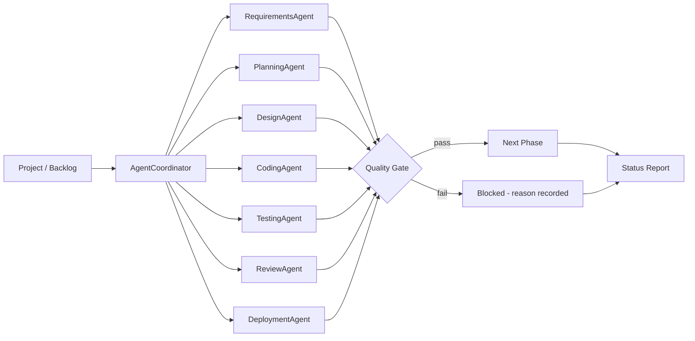

# TekunoAI AISDLC Management System

**Status: MVP prototype in active development**

Founder: Raghav Shah
Startup: TekunoAI

> TekunoAI builds AI-native digital products. This repository is the working
> prototype for one of those products: an AI-assisted software development
> lifecycle (AISDLC) management system. It is a real, runnable prototype, not
> a finished commercial product. No customers, revenue, or funding are claimed
> for this project.

## Problem

Software teams track work across requirements, planning, design, coding,
testing, review, and deployment, usually in disconnected tools. Status is
assembled by hand, quality gates are applied inconsistently, and it is hard
to see which tasks are blocked, why, and what should happen next.

## Solution

AISDLC models the whole lifecycle as an explicit pipeline:

- Every task moves through the same ordered phases.
- An AI agent coordinator assigns each task to a phase-specific agent.
- A task can only advance when the quality gate for its current phase passes.
- At any point the system produces a plain-English status report: how many
  tasks are in each phase, completion percentage, blocked tasks, and gate
  failures.

This prototype implements that core loop with no external services, so the
pipeline logic can be run, tested, and extended before any LLM or UI is wired
in.

## Features

- Ordered SDLC phases: requirements, planning, design, coding, testing,
  review, deployment, done
- Task model with priority, assignee, estimate, acceptance criteria,
  artifacts, test pass rate, approvals, and a full phase history
- Phase-specific agents (for example `RequirementsAgent`, `TestingAgent`)
  coordinated by a single `AgentCoordinator`
- Deterministic quality gates per phase (see `docs/architecture.md`)
- Blocked-task handling: a task that fails a gate stays in its phase and the
  failure reason is recorded, not silently skipped
- Status report generation (counts by phase, completion %, blocked list)
- End-to-end demo (`demo.py`) that runs three tasks through the full pipeline
- Unit tests using only the Python standard library

## Architecture



## Tech Stack

- Python 3.10+
- Standard library only (`dataclasses`, `enum`, `unittest`) - no pip installs
  required to run the demo or the tests
- Planned next layers (not in this prototype): LLM-backed agents, a web UI,
  and integrations with git hosting and issue trackers

## How to Run

```bash
# From the repository root

# 1. Run the end-to-end demo
python3 demo.py

# 2. Run the tests
python3 -m unittest discover -s tests -v
```

Expected demo output: three tasks assigned, moved phase by phase, quality
gates checked at each step, one intentionally blocked task demonstrating
gate failure handling, and a final status report showing 100% completion
for the demo project.

## Project Layout

```text
tekunoai-aisdlc/
  README.md
  LICENSE
  demo.py                  End-to-end pipeline demo
  pyproject.toml           Project metadata (stdlib only)
  aisdlc/
    __init__.py            Public exports
    models.py              Phase, TaskStatus, Task, Project
    gates.py               Quality gate definitions and evaluation
    coordinator.py         Agents and AgentCoordinator
    report.py              Status report generation
  docs/
    architecture.md        Detailed design notes
  tests/
    test_aisdlc.py         unittest test suite
```

## Roadmap

- [x] Core pipeline model: phases, tasks, quality gates
- [x] Agent coordinator with phase-specific agents
- [x] Status report generation
- [x] Demo and unit tests (stdlib only)
- [ ] Persist projects to disk (JSON) and reload them
- [ ] LLM-backed agent actions behind the same agent interface
- [ ] CLI for creating projects and tasks from the terminal
- [ ] Web dashboard for pipeline status
- [ ] GitHub integration: link tasks to branches and pull requests
- [ ] Apply the same coordinator pattern to TekunoAI's other products:
      AI-powered event management and the AI agent universe for shopping
      and purchasing negotiations

## Related TekunoAI Products (in development)

- **AI-powered event management**: planning, vendor and attendee
  coordination, scheduling, and communications assisted by AI agents.
- **AI agent universe**: a two-way agent platform where a user's agent and a
  seller or service agent can discover, compare, negotiate, and complete
  shopping and purchasing within the user's budget and approvals.

## License

MIT - see [LICENSE](LICENSE).
