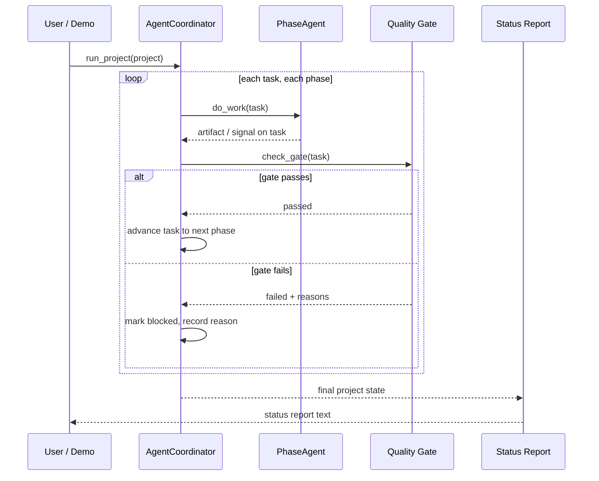

# Architecture - TekunoAI AISDLC Management System

Status: MVP prototype in active development
Founder: Raghav Shah, TekunoAI

## Overview

AISDLC turns the software development lifecycle into an explicit, testable
pipeline. A `Project` holds `Task` objects. Each task is always in exactly
one `Phase`. An `AgentCoordinator` drives tasks forward: the agent for the
current phase does its work, a quality gate is checked, and the task either
advances to the next phase or is marked blocked with a recorded reason.

The prototype deliberately has no external dependencies and no live LLM
calls. The pipeline, gates, and reporting are the product's core logic; LLM
integration is a later layer behind the existing agent interface.

## Components

### Models (`aisdlc/models.py`)

- `Phase` - ordered enum: requirements, planning, design, coding, testing,
  review, deployment, done. `Phase.next_phase` defines the only allowed
  forward movement.
- `TaskStatus` - todo, in_progress, blocked, done.
- `Task` - title, description, priority, acceptance criteria, estimate,
  assignee, current phase and status, artifacts produced per phase, test
  pass rate, approvals, a history log, and a blocked reason.
- `Project` - a named collection of tasks with completion and blocked
  aggregates.

### Quality gates (`aisdlc/gates.py`)

`check_gate(task)` evaluates the gate for the task's current phase and
returns a `GateResult` (passed flag plus human-readable failure reasons):

| Phase        | Gate requirement                                             |
|--------------|--------------------------------------------------------------|
| requirements | description present and at least 1 acceptance criterion      |
| planning     | assignee set and estimate > 0 hours                          |
| design       | `design_doc` artifact present                                |
| coding       | `implementation` artifact present                            |
| testing      | test pass rate >= 80%                                        |
| review       | at least 1 approval                                          |
| deployment   | `release_notes` artifact present                             |
| done         | terminal, no gate                                            |

Gates never mutate the task. Only the coordinator changes state, based on
the gate result.

### Agents and coordinator (`aisdlc/coordinator.py`)

- `PhaseAgent` - base class with one subclass per gated phase:
  `RequirementsAgent`, `PlanningAgent`, `DesignAgent`, `CodingAgent`,
  `TestingAgent`, `ReviewAgent`, `DeploymentAgent`.
- Each agent implements `do_work(task)`, producing the artifact or signal
  its phase is responsible for (for example, `DesignAgent` writes the
  `design_doc` artifact, `TestingAgent` sets the test pass rate).
- `AgentCoordinator`:
  - `assign_task(task)` - assigns the task to the agent for its current phase.
  - `step_task(task)` - one phase of work, then a gate check, then advance
    or block.
  - `run_task(task)` - steps until the task is done or blocked, with a
    max-steps safety limit.
  - `run_project(project)` - runs every task in a project.
  - Every assignment, gate pass, and block is recorded in
    `coordinator.events` for display and debugging.

In this MVP, agent work is a deterministic simulation. That is intentional:
it makes the full pipeline runnable and unit-testable offline. Replacing a
`do_work` implementation with an LLM call does not change the coordinator,
the gates, the models, or the report.

### Reporting (`aisdlc/report.py`)

- `generate_status_report(project)` - human-readable report: totals,
  completion percentage, blocked count, tasks by phase, blocked reasons,
  and per-task detail.
- `project_summary(project)` - the same data as a dict, for a future API
  or dashboard layer.

## Data flow

## Design decisions

1. **Stdlib only for the MVP core.** Anyone can clone and run the demo and
   tests with a stock Python 3.10+ install. This also keeps the proof of
   work verifiable: `python3 demo.py` and `python3 -m unittest discover`.
2. **Gates are separate from agents.** Agents do work; gates judge it. That
   separation is what stops a weak output from silently advancing.
3. **Blocked is a first-class outcome.** A blocked task keeps its phase,
   its reason, and its history, so the status report can explain it.
4. **History on every task.** Each task logs assignments, agent work, and
   phase transitions, giving an audit trail for free.

## Planned extensions

- Persistence: save and load projects as JSON.
- LLM-backed agents: implement `do_work` with model calls for drafting
  requirements, design docs, code, and review summaries, still behind the
  same gates.
- CLI and web dashboard on top of `project_summary`.
- GitHub integration: branch and pull request links as task artifacts.
- Reuse of the coordinator pattern for TekunoAI's event management and
  agent negotiation products, where the phases and gates differ but the
  assign, work, gate, advance-or-block loop is the same.
